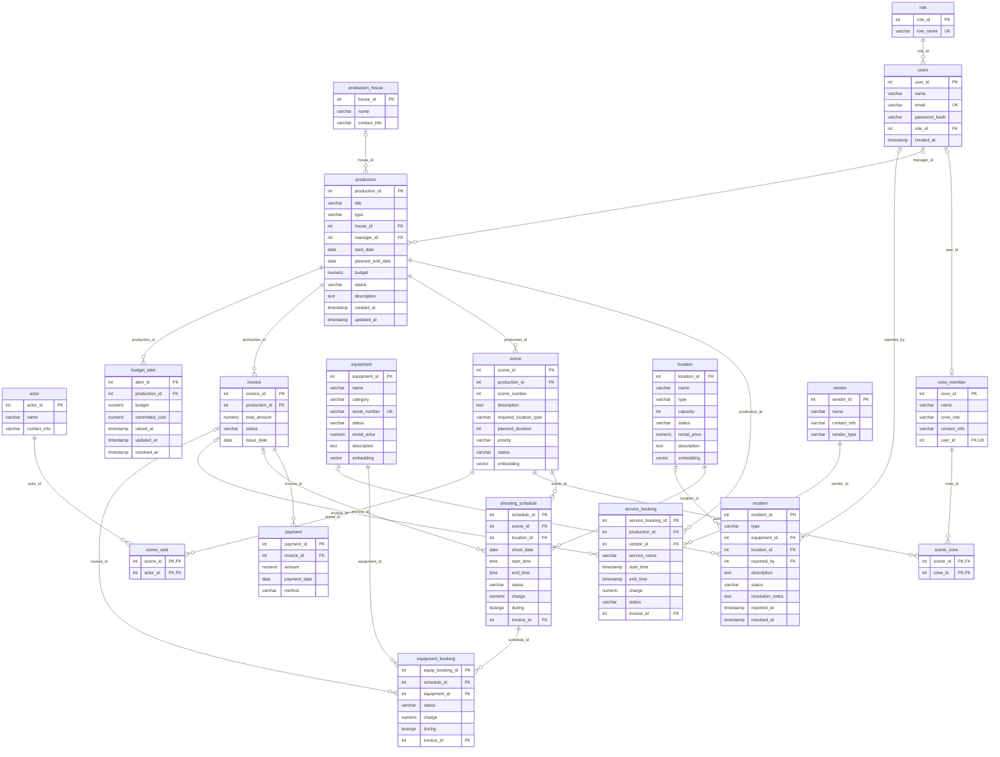

# CineGrid ER diagram

Generated from the live PostgreSQL schema by `node scripts/gen_erd.mjs`. Do not edit by hand: re-run after any schema change.

**Legend:** PK primary key, FK foreign key, UK unique.
`||--o{` one to many (parent required), `|o--o{` one to many (parent optional), `o|` one to one.
The EXCLUDE constraints (`no_location_overlap`, `no_equipment_overlap`) are not drawn; see `database/ddl/01_schema.sql`.
